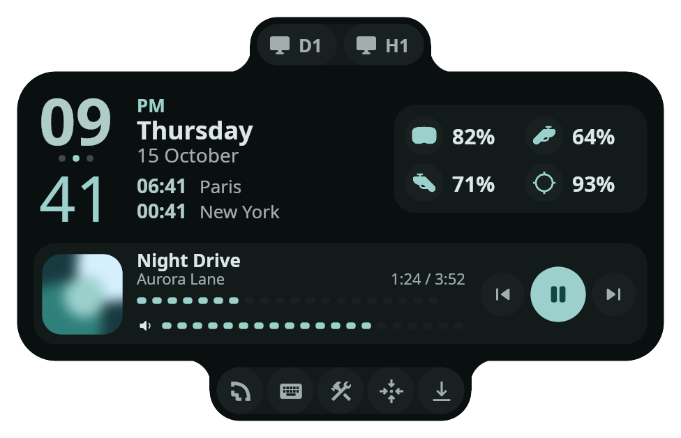
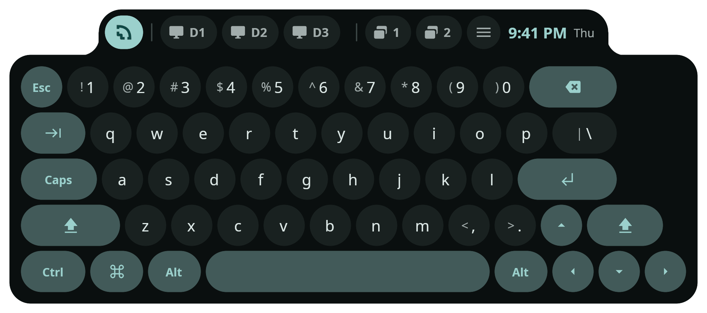
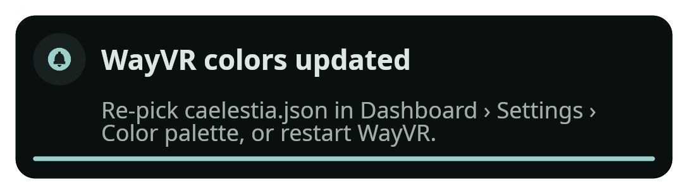
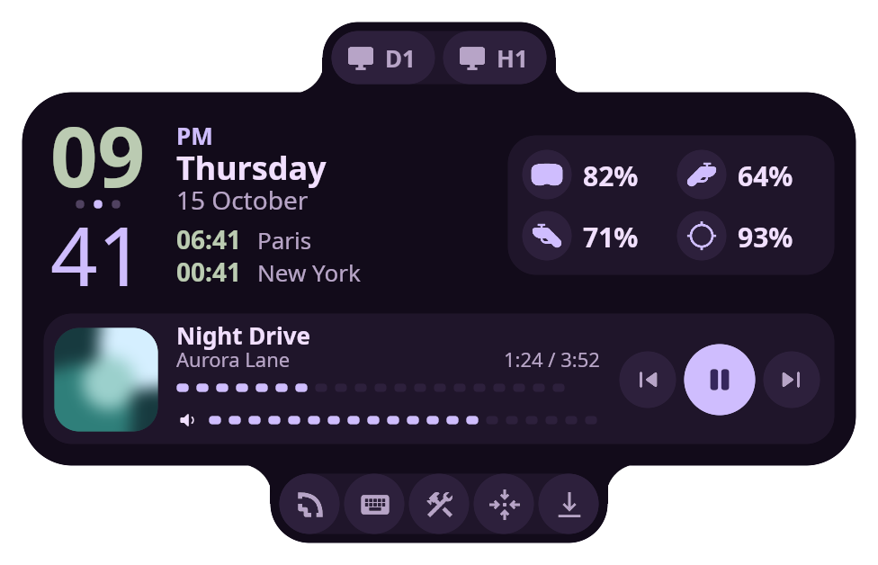
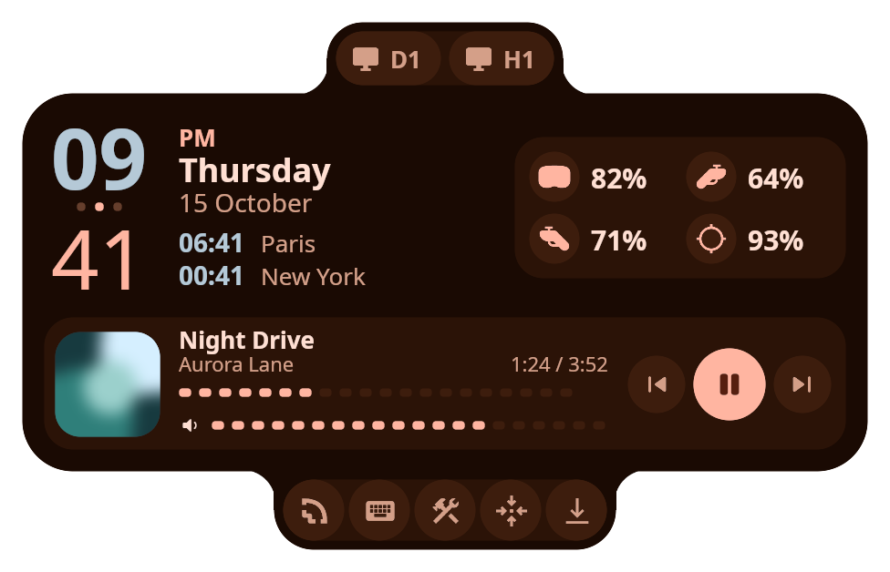

# m3-wayvr

A Material 3 Expressive theme for [WayVR](https://github.com/wayvr-org/wayvr) that matches the [Caelestia](https://github.com/caelestia-dots/shell) shell. Its colors follow your wallpaper, and it adds media controls to the watch. Tested against WayVR 26.8.0.

<p align="center"></p>

<p align="center"></p>

<p align="center"></p>

<p align="center">
  
  
</p>

The renders are drawn by WayVR's own renderer (its `uidev` testbed with an offscreen PNG mode; see `render/`) with sample data. The large ones use a palette synced from a Caelestia wallpaper; the two small ones use preset palettes.

## What's in it

- **Watch:** two drawer tabs melt out of the panel with curved-in corners, like Caelestia's drawers. The top tab holds your monitor/overlay (or set) chips; the bottom tab holds the toolbar (dashboard, keyboard, edit mode, recenter, fix floor). In between are the Caelestia dashboard clock (hours over minutes with a dot divider, 12h or 24h), device batteries in a two-column grid, and the media card.
- **Media card:** rounded-square album art, title, artist, elapsed/total time, previous / play-pause / next, a tap-to-seek bar, and a volume bar for the player's own volume with a mute button. It hides itself while nothing is playing.
- **Keyboard:** pill-shaped keys with primary-tinted modifiers. The overlay bar is a drawer tab on the keyboard's top edge.
- **Toasts:** a Caelestia notification card with an icon badge and a thin primary countdown bar.
- **Colors:** generated from Caelestia's `~/.local/state/caelestia/scheme.json` and regenerated on every wallpaper change. Preset palettes (violet, blue, teal, coral; dark and light) are available if you don't use Caelestia.

## Install

Needs [bun](https://bun.sh) for the sync scripts and `playerctl` for the media card.

```bash
git clone https://github.com/dim-ghub/m3-wayvr ~/Projects/m3-wayvr
cd ~/Projects/m3-wayvr
./install.sh            # layouts + wallpaper-synced palette + background services
wayvr --replace
```

What it does:

- Copies `theme/` into `~/.config/wayvr/theme/`, backing up any layouts that aren't from this theme as `*.bak`.
  - **12/24-hour clock:** WayVR doesn't pass this setting to layouts, so the installer reads `clock_12h` from your config and writes the matching format into the watch. Run `./install.sh` again if you change it.
  - **Toast text:** the label ids WayVR fills in changed after 26.8.0. The installer keeps the pair your `wayvr` binary uses.
- Writes `~/.config/wayvr/palettes/caelestia.json` from your current scheme, and sets `color_palette`, `ui_round_multiplier: 2.0` and `ui_gradient_intensity: 0.0` in `conf.d/m3-expressive.yaml`. If the dashboard's `conf.d/zz-saved-config.json5` exists, those keys are updated there too, because that file loads last.
- Starts two background services:
  - **`wayvr-caelestia-sync`** regenerates the palette when the wallpaper changes.
  - **`wayvr-media`** mirrors the active player into the watch.

  On OpenRC (Artix, Gentoo) both are user services in `~/.config/rc/init.d/`, logging to `$XDG_RUNTIME_DIR/<name>.log`. On systemd the palette sync is a user path unit; on anything else, the installer prints the commands to autostart.

To use a preset palette instead of the wallpaper sync, run `./install.sh --preset teal dark`. To uninstall, run `./install.sh --uninstall`.

### After a wallpaper change

WayVR can't reload a palette while it's running. When the palette changes during a session, the sync sends a notification, which WayVR also shows in your headset. Re-pick `caelestia.json` under **Dashboard › Settings › Color palette**, or restart WayVR.

### Starting WayVR with SteamVR

`autostart/wayvr-steamvr.sh` waits for SteamVR's compositor and starts `wayvr --openvr` from your desktop session, so WayVR gets your Wayland and D-Bus environment. Start it once per login, for example from Hyprland's autostart. WayVR's own `--install` autolaunch starts it from SteamVR instead, which WayVR's help says may cause issues.

## How it works

### Colors

| WayVR slot | Caelestia role | Used for |
|---|---|---|
| `background_contrast` | `surface` | Panel bodies and drawer tabs |
| `background` | `surfaceContainer` | Cards and chip tracks |
| `background_variant` | `surfaceContainerHigh` | Buttons, chips, keys |
| `primary` / `on_primary` | same | Toggled overlays, minutes, play button, progress |
| `secondary` | `secondary` | Hours and timezone clocks |
| `tertiary` / `on_tertiary` | tertiary palette tone 30/90 (90/10 in light mode) | Hover on every button and key |
| `success` | green harmonized toward `primary` | Success states (newer WayVR only) |
| `danger` / `on_danger` | `error` / `onError` | Low battery |
| `outline` | `outlineVariant` | Separators |

`tertiary` uses a container tone rather than Caelestia's accent: WayVR's code uses it as the hover fill, and Caelestia's tertiary accent is often close to white.

### Media card

WayVR has no media support, but `wayvrctl panel-modify` can set text, images, colors and visibility on any layout element with an id. `media/media-sync.ts` polls `playerctl` once a second and pushes only what changed. It downloads http(s) album art to `~/.cache/wayvr-media`.

The buttons call `playerctl` through WayVR's `::ShellExec` action. WayVR can only attach commands to buttons, not sliders, so the seek and volume bars are rows of 20 tappable segments. Each segment runs `media/seek.sh <fraction>` or `media/volume.sh <level>`.

The services read `DBUS_SESSION_BUS_ADDRESS` from the running WayVR process. OpenRC's user `dbus` service runs a separate bus from the one your desktop session's apps use.

### Compatibility

The layouts use the original layout dialect (no `version="2"`), which 26.8.0 requires and newer builds still accept. Palette files only get `success`/`on_success` when the installed `wayvr` binary knows those fields (`wayvr-compat.ts`), because WayVR rejects palette files with fields it doesn't expect.

## Limits

These come from WayVR's UI toolkit, not from the theme:

- **Font:** labels use your system's default sans-serif. Layout files can't pick a typeface.
- **Toggled buttons don't change shape.** Only their colors change, so there's no Caelestia-style circle-to-rounded-square morph.
- **Animation:** no spring motion curves. Only overall speed (`ui_animation_speed`) is adjustable.
- **The watch's position on the controller is fixed in WayVR's code.** The layout is kept wider than the stock watch so it clears the controller model.
- **Device names aren't shown.** WayVR only gives the watch an icon and a battery level per device.
- **The dashboard is built into WayVR,** so it only gets the palette and the rounding multiplier.

## Development

```bash
bun install
bun sync-caelestia.ts --print                    # preview the synced palette
bun generate.ts --seed "#3F51B5" --name indigo   # extra preset palettes
UIDEV=/path/to/uidev python3 render/render.py    # regenerate renders/
```

`render/render.py` renders `renders/*.png` with a WayVR v26.8.0 checkout whose `uidev` testbed has `render/uidev-offscreen.patch` applied. The script's docstring has the setup steps.
